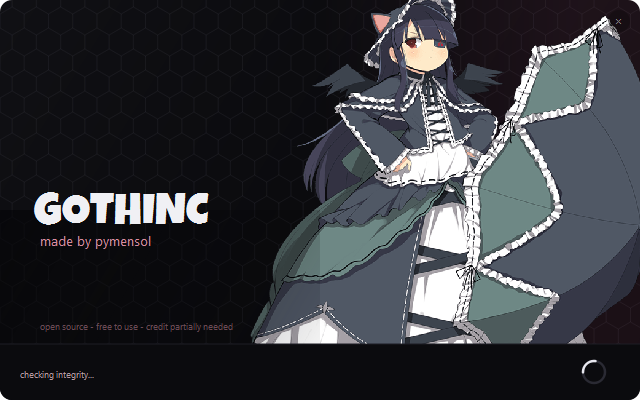
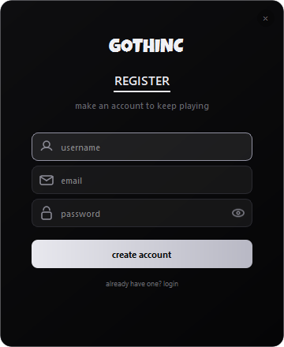
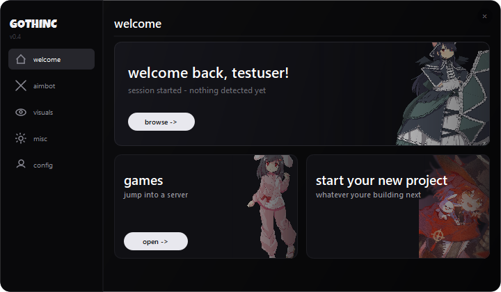
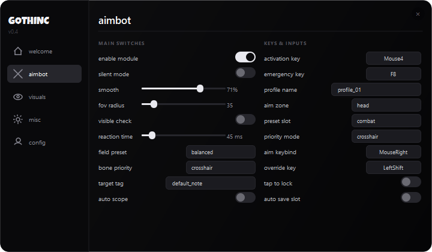

# gothinc

wanted a launcher-style ui so i made one. splash screen that dies
into a real login, then a dashboard full of controls u can steal
for ur own apps. python + pyside6, black and white.

## the chain

- `main.py` - splash screen with painted art, a little arc spinner and
  fake loading steps. when its done it closes itself and opens the
  login window, like real launchers do
- `login.py` - register/login window with field icons and a show/hide
  password eye. register actually works btw - hashes user+pass into
  accounts.json (gitignored so it stays on your machine)
- `app.py` - the dashboard. icon sidebar, a welcome page with a hero
  banner that says your real username, and settings pages with actual
  working sliders, dropdowns, toggles and keybind capture

## use it for your own thing

steal the pieces: the rounded frameless window pattern, the sidebar +
page swap, the toggle pill, the keybind button, the arc spinner. its
all plain qpainter and qwidget, no frameworks.

## run

    py -3.14 main.py

register an account, login, click around. its just a ui shell - it
doesnt hook or inject anything, the settings are placeholders.

## assets

- `goth.png`, `bunny.png`, `card2.png` - the renders in the ui
- `luckiest.ttf` - luckiest guy, free clone of fortnites font
- art is from safebooru, credit to the artists
